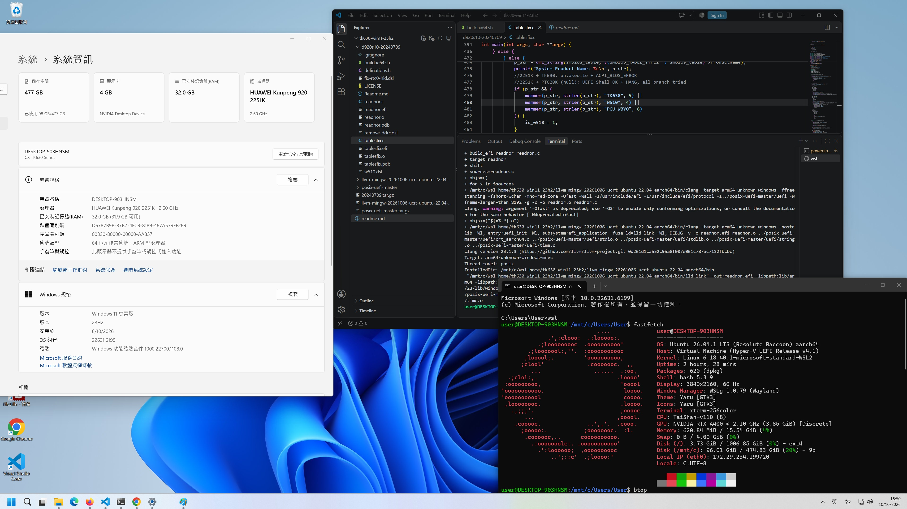

# Win11 ARM 23H2 "ACPI fix" EFI build in general Ubuntu x86 server #



## How to use ##

*Success in THTF TK630 only. PT620K fails for all combinations even they are in same board (BC32MBHB). BIOS / UEFI are differnt.*

- **Prepare a empty FAT32 USB**. Recommended a 2GB USB DOM. I used Rufus "not bootable GPT USB" to format it.
- Place `tablesfix-tk630-nochain.efi` as `/efi/boot/bootaa64.efi`
- Set boot order "This USB bootloader > Win11 ARM installation USB or OS Disk"

### Hardware advice in UEFI layer ###

- *You can use RDIMM (useful on 2024), 4RX4 works. Up to 2933.* [dixyes](https://dixyes.dev/posts/2023/03/27/run-windows-on-d920s10/)
  - M2 / GPUs are all in PCIE 3.0.
  - **Kunpeng920 is a model series, and has server and desktop variants.** There are still active development for production servers and BIOS, but the microcode issue in "arm v8.2" is consistint, requires BIOS fix. 
  - The microcode may also *cascasde into issues dedicated to USB install media*. [6DammK9/hisi_raid-sp686c-dkms](https://github.com/6DammK9/hisi_raid-sp686c-dkms#extra-installing-ubuntu-2404-on-the-kunpeng920-server)
- For basic display, use **MTT S30** or **AMD Radeon RX series** as primary GPU.
  - JM9100 cannot get into winodws (works in x86 or linux).
  - Nvidia / ASPEED etc. are all no-no (cannot boot, UEFI crash)
- TPM slot refers to [BC11TPMA](https://itprice.com/huawei/bc11tpma.html), which is 16-pin.
  - However CSM / Secureboot / TPM etc. are all absent in BIOS.
- **Prepare a good power button.** OS shutdown / reboot etc. will return to last UEFI state (e.g. Winodws logo) and you need to perform power cycle manually.

### Driver support in Win11 ARM 23H2 ###

*This is a whitelist. Driver just don't exist.*

- **Nvidia 616.00 N1X preview** [Nvidia](https://forums.developer.nvidia.com/t/rtx-spark-developer-preview/377106)
  - Install from list > pick from floppy > Nvidia Desktop Device
  - Support from GTX16 (tested V100 and GT1030 and it fails), works on RTX3050 and A400.
  - Place in secondary PCIE slot.
- **Qualcomm NFA765 a.k.a. WCN6856.** [Lenovo](https://support.lenovo.com/us/en/downloads/ds556203-qualcomm-wireless-lan-driver-for-windows-11-arm-version-21h2-or-later-thinkpad-x13s-gen-1-types-21bx-21by)
  - However I'm stuck in 0xC00000E5 error.
- **Realtek USB GbE** [treexy](https://treexy.com/products/driver-fusion/database/network-adapters/realtek/usb-c-dock-gen2-ethernet/)
  - Usually common USB LAN adapter e.g. Ugreen are Realtek already
  - May have sleeping problem.
  - Yep, onboard LAN has no driver obviously.
  - Yep, Realtek USB Wifi is not included. Use Wifi extenders that has LAN port instead.
  - ~~LTE / 5G module are too much for a desktop.~~

### Software worth mentioning ###

- Microsoft store is missing. Restore with [DaBigBlob/ms-store-arm64](https://github.com/DaBigBlob/ms-store-arm64).
- FileZilla for development without VSCode. [minnyres/filezilla-windows-arm64](https://github.com/minnyres/filezilla-windows-arm64)
- CPU-Z / HWMonitor crash, HWiNFO is close to empty, GPU-Z / FurMark2 / CrystalDiskInfo works fine.
- Edge / Chrome / Firefox all has arm64, but they can crash at anytime.
- Docker Desktop / WSL etc. are working fine. I'm push this repo with this machine.
  - Barebone Ubuntu 24.04 does not figured out yet, but I can run 26.04 here can cross compile codes.

## Build guide ##

- Intention: My TK630 / PT620 doesn't work based from [#3](https://github.com/dixyes/d920s10/issues/3). Rebuild code is *a bit complicated*.
  - Getting the concept on cross compiling, especially Linux x86 to Winodws ARM (instead of Winodws x86 to Linux ARM), is a bit messy.
  - After a bit of research, it can be solved elegently by [a built toolchain](https://github.com/mstorsjo/llvm-mingw).

- Using the release version [20240709](https://github.com/dixyes/d920s10/releases/tag/20240709) instead of the recent dynamic one.

- ISO: [Windows 11 23H2 ARM64 (French)](https://archive.org/details/windows-11-23-h-2-arm-64)

```sh
wget https://github.com/dixyes/d920s10/archive/refs/tags/20240709.tar.gz
tar -xzf 20240709.tar.gz
# Export tgz from https://gitlab.com/bztsrc/posix-uefi
git pull https://gitlab.com/bztsrc/posix-uefi

# https://voxelmanip.se/2024/12/10/cross-compiling-for-windows-using-llvm-mingw/
wget https://github.com/mstorsjo/llvm-mingw/releases/download/20260922/llvm-mingw-20260922-ucrt-ubuntu-22.04-aarch64.tar.xz
tar -xf llvm-mingw-20260922-ucrt-ubuntu-22.04-aarch64.tar.xz

# Ref: https://www.biosconfessions.com/posts/from-silicon-to-shell/2-toolchain-setup/
# Ref: https://www.reddit.com/r/rust/comments/s45mn7/how_to_crosscompile_from_linux_to_windows/?show=original
# LLVM-MinGW Clang Toolchains. Warning: 2-3GB of space (SDK matters)
sudo apt install gcc-aarch64-linux-gnu binutils-aarch64-linux-gnu clang llvm mingw-w64

# 11.4.0 (22.04), 13.3.0 (24.04)
aarch64-linux-gnu-gcc --version
# 14.0.0 (22.04), 18.1.3 (24.04)
clang -v
# exec format error
# ./llvm-mingw-20260922-ucrt-ubuntu-22.04-aarch64/bin/clang -v
# 23.1.2
./llvm-mingw-20260922-ucrt-ubuntu-22.04-x86_64/bin/clang -v

# Build first: https://gitlab.com/bztsrc/posix-uefi
# 920 special: Must be ARM
cd posix-uefi-master/uefi

# USE_GCC=1
ARCH=aarch64 CROSS_COMPILE=aarch64-linux-gnu- make

cd ../../

cd d920s10-20240709
# Codes modified! See this repo: [tablefix.c, buildaa64.sh]
# It should works already.
POSIX_UEFI_PATH=../posix-uefi-master ./buildaa64.sh 

# Probably need MSVC (msvc-wine)
# unable to execute command: Executable "lld-link" doesn't exist!

# Need QEMU with --sysroot
# lld-link: error: ../posix-uefi-master/uefi/string.o: machine type x64 conflicts with arm64

# Ref: https://stackoverflow.com/questions/78720570/cross-compiling-for-aarch64-with-clang-built-from-source
# Just make clean and try again!
```

- Success build log:

```log
+ '[' '!' -d ../posix-uefi-master ']'
+ CFLAGS=(-target arm64-unknown-windows -ffreestanding -fshort-wchar -mno-red-zone -Ofast -Wall -I/usr/include/efi -I/usr/include/efi/protocol "-I${POSIX_UEFI_PATH}/uefi" -Wframe-larger-than=8192)
+ LDFLAGS=(-target arm64-unknown-windows -nostdlib '-Wl,-entry:uefi_init' '-Wl,-subsystem:efi_application' -fuse-ld=lld-link '-Wl,-DEBUG')
+ build_efi tablesfix tablesfix.c
+ target=tablesfix
+ shift
+ sources=tablesfix.c
+ objs=()
+ for x in $sources
+ /home/user/opt_261005/llvm-mingw-20260922-ucrt-ubuntu-22.04-x86_64/bin/clang -target arm64-unknown-windows -ffreestanding -fshort-wchar -mno-red-zone -Ofast -Wall -I/usr/include/efi -I/usr/include/efi/protocol -I../posix-uefi-master/uefi -Wframe-larger-than=8192 -g -c -o tablesfix.o tablesfix.c
clang: warning: argument '-Ofast' is deprecated; use '-O3' to enable only conforming optimizations, or consult the documentation for the same behavior [-Wdeprecated-ofast]
+ objs+=("${x%.*}.o")
+ /home/user/opt_261005/llvm-mingw-20260922-ucrt-ubuntu-22.04-x86_64/bin/clang -target arm64-unknown-windows -nostdlib -Wl,-entry:uefi_init -Wl,-subsystem:efi_application -fuse-ld=lld-link -Wl,-DEBUG -v -o tablesfix.efi tablesfix.o ../posix-uefi-master/uefi/crt_aarch64.o ../posix-uefi-master/uefi/stdio.o ../posix-uefi-master/uefi/stdlib.o ../posix-uefi-master/uefi/string.o ../posix-uefi-master/uefi/time.o
clang version 23.1.2 (https://github.com/llvm/llvm-project.git 85ac560262434c9ccfc0c183ec22d4138ed647fb)
Target: arm64-unknown-windows-msvc
Thread model: posix
InstalledDir: /home/user/opt_261005/llvm-mingw-20260922-ucrt-ubuntu-22.04-x86_64/bin
 "/home/user/opt_261005/llvm-mingw-20260922-ucrt-ubuntu-22.04-x86_64/bin/lld-link" -out:tablesfix.efi -libpath:lib/arm64 -libpath:atlmfc/lib/arm64 -libpath:/home/user/opt_261005/llvm-mingw-20260922-ucrt-ubuntu-22.04-x86_64/lib/clang/23/lib/windows -nologo -entry:uefi_init -subsystem:efi_application -DEBUG tablesfix.o ../posix-uefi-master/uefi/crt_aarch64.o ../posix-uefi-master/uefi/stdio.o ../posix-uefi-master/uefi/stdlib.o ../posix-uefi-master/uefi/string.o ../posix-uefi-master/uefi/time.o
+ build_efi readnor readnor.c
+ target=readnor
+ shift
+ sources=readnor.c
+ objs=()
+ for x in $sources
+ /home/user/opt_261005/llvm-mingw-20260922-ucrt-ubuntu-22.04-x86_64/bin/clang -target arm64-unknown-windows -ffreestanding -fshort-wchar -mno-red-zone -Ofast -Wall -I/usr/include/efi -I/usr/include/efi/protocol -I../posix-uefi-master/uefi -Wframe-larger-than=8192 -g -c -o readnor.o readnor.c
clang: warning: argument '-Ofast' is deprecated; use '-O3' to enable only conforming optimizations, or consult the documentation for the same behavior [-Wdeprecated-ofast]
+ objs+=("${x%.*}.o")
+ /home/user/opt_261005/llvm-mingw-20260922-ucrt-ubuntu-22.04-x86_64/bin/clang -target arm64-unknown-windows -nostdlib -Wl,-entry:uefi_init -Wl,-subsystem:efi_application -fuse-ld=lld-link -Wl,-DEBUG -v -o readnor.efi readnor.o ../posix-uefi-master/uefi/crt_aarch64.o ../posix-uefi-master/uefi/stdio.o ../posix-uefi-master/uefi/stdlib.o ../posix-uefi-master/uefi/string.o ../posix-uefi-master/uefi/time.o
clang version 23.1.2 (https://github.com/llvm/llvm-project.git 85ac560262434c9ccfc0c183ec22d4138ed647fb)
Target: arm64-unknown-windows-msvc
Thread model: posix
InstalledDir: /home/user/opt_261005/llvm-mingw-20260922-ucrt-ubuntu-22.04-x86_64/bin
 "/home/user/opt_261005/llvm-mingw-20260922-ucrt-ubuntu-22.04-x86_64/bin/lld-link" -out:readnor.efi -libpath:lib/arm64 -libpath:atlmfc/lib/arm64 -libpath:/home/user/opt_261005/llvm-mingw-20260922-ucrt-ubuntu-22.04-x86_64/lib/clang/23/lib/windows -nologo -entry:uefi_init -subsystem:efi_application -DEBUG readnor.o ../posix-uefi-master/uefi/crt_aarch64.o ../posix-uefi-master/uefi/stdio.o ../posix-uefi-master/uefi/stdlib.o ../posix-uefi-master/uefi/string.o ../posix-uefi-master/uefi/time.o
```

- Codes changed:
  - **TK630 behaves like W510!** [ACPI_BIOS_ERROR](https://dixyes.dev/posts/2023/03/27/run-windows-on-d920s10/) is reproduced. [W510 case](https://github.com/dixyes/d920s10/issues/3) has been expended.
  - **TK630 does not have UEFI shell!** [Synchronous Excception](https://github.com/dixyes/d920s10/issues/2) appears after chainload. Therefore chainload has been disabled. Now it exits to BIOS screen then boot overridde.
  - *Boot menu key is F3.* (PT620K is F4)

- Post install EFI:
  - Revert the swap and use the no-chain EFI again. Now it is magically carry to the next UEFI option i.e. OS Boot.
  - BSOD `CLOCK_WATCHDOG_TIMEOUT` appears after first OS boot.
  - Removing USB key will have `ACPI_BIOS_ERROR`.
  - ~~Use the "non W510 no chain"?~~ **Use a tiny (say 2GB, must be FAT) USB with the exact same EFI file path.** [Ref.](https://developer.seco.com/how-to/uefi-bootable-usb/) will magically get into Windows!
  